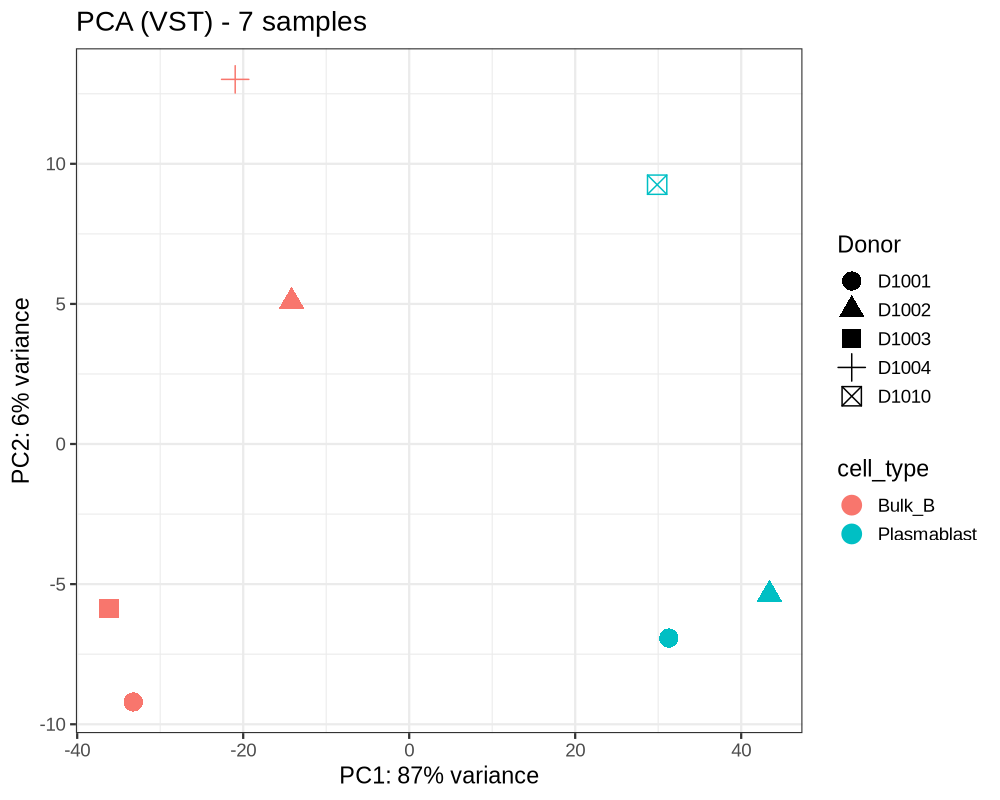
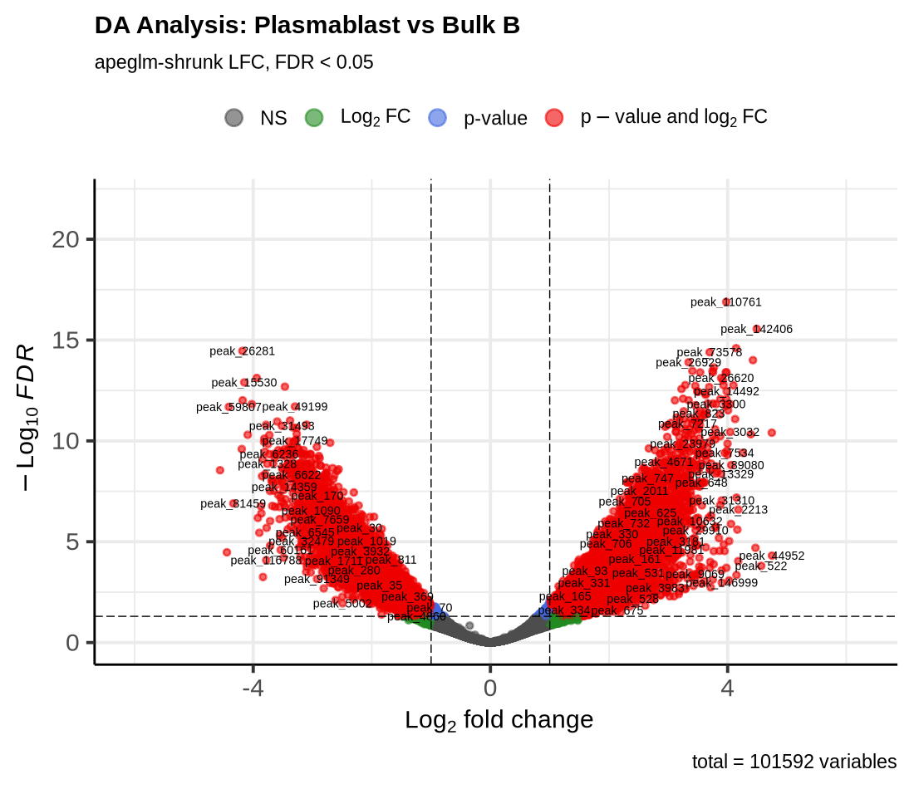

# Chromatin accessibility across B-cell differentiation

An ATAC-seq analysis comparing **bulk B cells with plasmablasts**, from raw reads through to transcription-factor motif enrichment. A three-week internship project at the Department of Medical Bioinformatics, Universitätsmedizin Göttingen.


**[Read the full report (PDF)](report/report.pdf)** · **[Discussion slides](slides/discussion_deck.pptx)** · Data: [GSE118189](https://www.ncbi.nlm.nih.gov/geo/query/acc.cgi?acc=GSE118189) (Calderon et al. 2019, *Nature Genetics*)

---

## The question

Resting B cells and plasmablasts are two stages of one lineage. Getting from the first to the second means dismantling the B-cell identity programme and installing an antibody-secreting one. Which parts of the genome open and close as that happens, and which transcription factors drive it?

## The answer

14,662 of 101,592 tested regions are differentially accessible (FDR < 0.05, |log2FC| ≥ 1): 7,976 opening in plasmablasts, 6,686 closing. Motif enrichment splits cleanly by direction.

| More accessible in plasmablasts | *p* | | More accessible in bulk B | *p* |
|---|---|---|---|---|
| IRF4 | 1e-202 | | Elf4 (ETS) | 1e-324 |
| IRF3 | 1e-147 | | PU.1 | 1e-306 |
| IRF8 | 1e-136 | | ELF5 (ETS) | 1e-289 |
| bZIP:IRF (BATF) | 1e-111 | | SpiB | 1e-260 |

The results are consistent with an **ETS-associated programme giving way to an IRF-associated one** — PU.1 and SpiB being the factors that hold B-cell identity in place. Motif enrichment measures sequence composition, not occupancy, so this is a regulatory shift the data are compatible with rather than one they demonstrate.

<p align="center">
  
  
</p>

---

## Five things the data made me go back and change

The analysis itself is a standard pipeline. What took the three weeks was noticing where it was about to go wrong.

### The Week 1 sample is not a B cell

The library handed out for the pre-processing exercise, SRR7650763, turns out to be an immature NK-cell sample. Carrying it into the B-cell comparison would have produced a clean-looking result about nothing. Week 1 is therefore reported as a methods exercise and kept entirely separate from the biology in Weeks 2–3, and the chromosome-22 peak comparison drawn from it is labelled as the rough cross-lineage approximation it is, not as a recovery rate.

### The assignment's statistical design does not fit the samples

The assignment specified a paired design, `~ Donor + cell_type`. Checking the metadata first showed that only 2 of the 5 donors contributed both cell types, which leaves too few residual degrees of freedom to fit it on all seven samples. Rather than run it anyway or quietly drop the donor term, the main analysis uses `~ cell_type` on all seven samples and the paired design runs on the four matched samples as a sensitivity check. It recovered 3,692 of its 3,696 differential regions from the main analysis with complete agreement on direction — reassuring, but two donors cannot rule out residual confounding, and the report says so rather than claiming the design was validated.

### Two sources specified different filters, so I measured instead of choosing

The slides specify a low-count filter of ≥ 10 counts in ≥ 3 samples; the assignment PDF specifies 4. Both were run to the end, with everything downstream held identical. 95.7% of the N = 4 differential regions are also N = 3 regions, log2 fold changes correlate at *r* = 0.9999 across the 80,197 regions tested under both, and direction agreement among regions differential in either arm is 100%. The threshold is not a load-bearing choice, and that is now a measurement rather than an argument. → [`docs/filter_sensitivity.md`](docs/filter_sensitivity.md)

### The GO background was wrong, so I quantified how wrong

Enrichment run against the whole annotated genome includes genes the experiment had no way of reporting. The defensible universe is the 16,776 protein-coding genes (of 19,419) whose TSS lies within 5 kb of a consensus region. That is a 13.6% reduction — small enough to bound how much the original choice could have mattered, and a finding in its own right about how much of the promoter landscape is accessible in primary immune cells. → [`docs/go_background.md`](docs/go_background.md), [`results/gprofiler_background.txt`](results/gprofiler_background.txt)

### I checked the biology before trusting the labels

Before running any statistics, raw counts at the *PRDM1* locus were inspected directly. They are 7–20× higher in all three plasmablast samples, which is what the plasma-cell master regulator should do. Had the sample labels been swapped anywhere upstream, this is where it would have shown — and nothing else in the pipeline would have caught it.

**Two further limitations are documented rather than hidden.** Nearest-TSS gene assignment is an assumption, not a measurement. Consensus regions are merges of broadPeak calls, so the centre HOMER scans is not a called summit; the width distribution is reported (median 350 bp, 99th percentile 2,125 bp) so the reader can judge what that costs.

---

## Pipeline

| Stage | Tools | Output |
|---|---|---|
| Manual pre-processing | Cutadapt, Bowtie2, SAMtools, Picard, BEDTools, MACS3 | 1,035 peaks, validated against an nf-core reference run |
| Consensus peak set | BEDTools, featureCounts | 155,948 regions × 7 samples |
| Differential accessibility | DESeq2, apeglm | 14,662 differential regions |
| Downstream | HOMER, g:Profiler, IGV | motif enrichment, GO terms, six target genes |

Week 1 was run by hand rather than through nf-core, deliberately, to understand what each filter actually does. Comparing the two pipelines on the same library gave duplication within three percentage points (76.59% vs 73.76%) and the same usable read fraction at the end (20.21% vs 20.73%).

One design choice worth flagging: HOMER was run against the full consensus peak set rather than random genomic sequence. That changes the question from "what is in open chromatin" to "what distinguishes regions that changed from regions open in both cell types" — which is the one worth asking.

## Layout

```
report/     LaTeX source, figures, compiled PDF
scripts/    shell pipeline (weeks 1-3)
  R/        DESeq2 analysis and sensitivity checks
results/    differential regions, gene lists, motif tables, GO background
slides/     discussion-session deck
docs/       follow-up analyses done after submission
```

Paths in the scripts point at a university cluster and are set through environment variables (`PEAK_DIR`, `BAM_DIR`, `HOMER_REF`). Raw FASTQ and BAM files are not included; they are available from GEO under GSE118189.

```bash
cd report && latexmk -pdf report.tex    # rebuild the report
```

## Software

Cutadapt 4.7 · Bowtie2 2.5.5 · SAMtools 1.24 · Picard 3.4.0 · BEDTools 2.31.1 · MACS3 3.0.2 · MultiQC 1.35 · Subread/featureCounts 2.1.1 · R 4.5.3 · DESeq2 1.50.2 · apeglm 1.32.0 · HOMER 4.11 · g:Profiler e114_eg62_p19

## Note

An AI assistant was used for language refinement, figure preparation and technical troubleshooting. The analytical decisions, interpretation and conclusions are my own.
